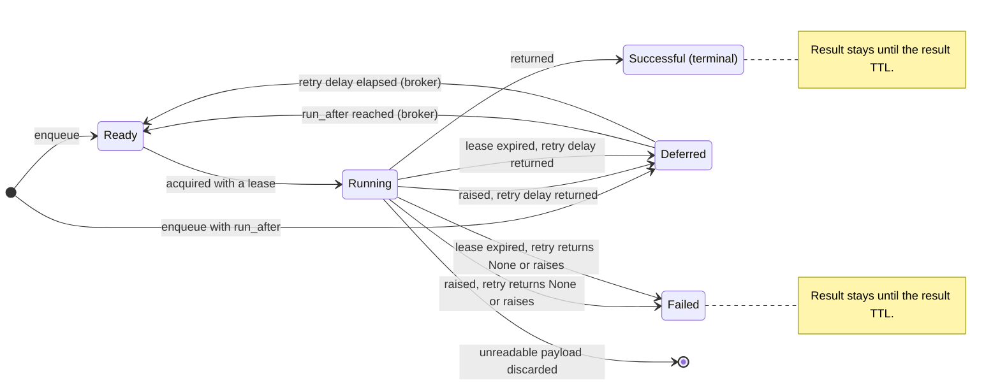
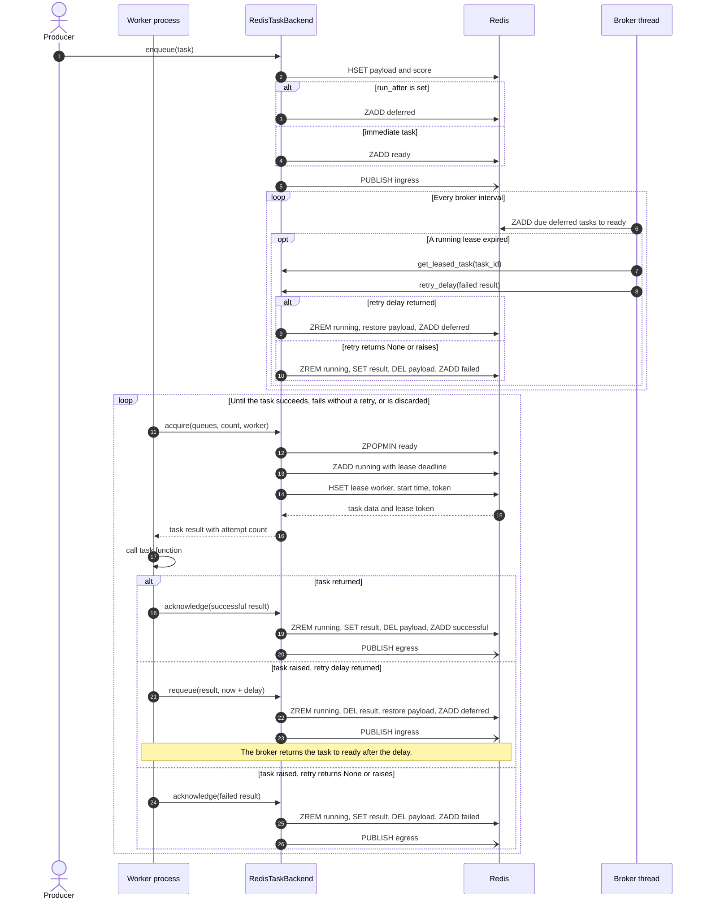
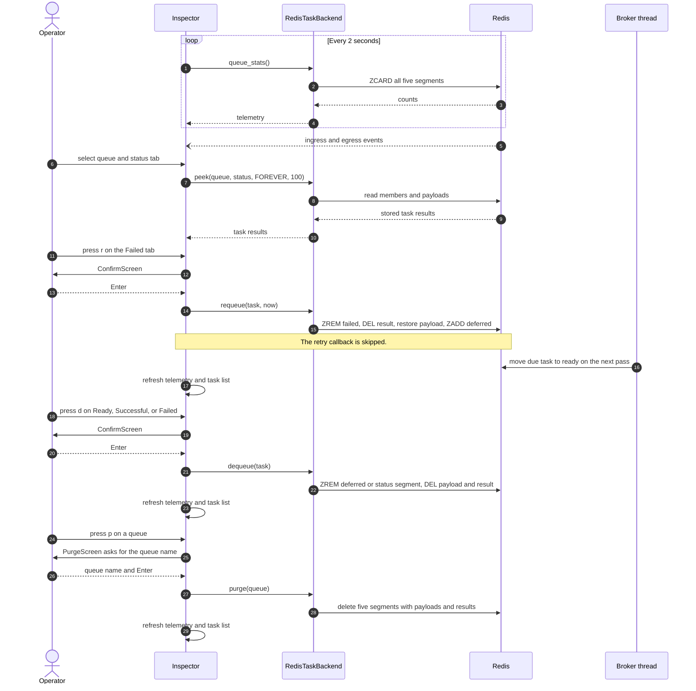

# Contributing

When writing code, you MUST ALWAYS follow the [naming-things](https://github.com/codingjoe/naming-things/blob/main/README.md) guidelines.

<!--
Bots/Agents MUST use:
curl -sSL https://raw.githubusercontent.com/codingjoe/naming-things/refs/heads/main/README.md
-->

## Design Principles

- Durability – We recover from any failures, even poorly written tasks.
- Consistency – We never lose data, even if someone unplugs the power or network.
- Utilization – We keep the CPU saturated with tasks, not with idle time or waiting for locks.

We require a persistent Redis without eviction.

Redis connections explicitly load with `decode_responses=True`, so all values
read from Redis are strings. We do not guard against Redis data altered
mid-flight. We fail loudly instead. These are deliberate design decisions.

## Task lifecycle

A task lives in one of five Redis sets. READY and DEFERRED hold pending
work. RUNNING holds leased tasks. SUCCESSFUL and FAILED hold published
results.



SUCCESSFUL is terminal for the task. A successful result stays in Redis for
the result TTL, so `get_result()` can read it. The task never returns to the
queue. The TTL reaper only removes the stored result.

FAILED is terminal for the worker.

A retry never enters FAILED. When the task raises, the worker calls the task's
retry callback. A returned `datetime.timedelta` moves the task to DEFERRED with
that delay. The broker moves it to READY when the delay elapses, and the next
lease increments `attempts`, which is `len(worker_ids)`. The callback reads the
count through `TaskContext.attempt`. `ExponentialBackoff` keeps returning a
delay until `max_retries`. A callback that returns `None` or raises ends
retrying, and the task is acknowledged as FAILED.

The Ready tab shows READY and DEFERRED tasks. Result payloads expire after the
result TTL. The SUCCESSFUL and FAILED sets are trimmed on later
acknowledgements.

## Task flow

The worker process leases ready tasks, runs them, and acknowledges the result.
The broker thread moves due deferred tasks and reaps expired leases. An expired
lease marks the task FAILED with an `AcknowledgementTimeoutError`. The retry
rule then decides between requeue and acknowledge.



Acknowledge only removes the RUNNING entry when the lease token matches. A worker that lost its lease cannot publish a result. The broker then owns the retry decision for that task.

## Inspector actions

The inspector reads on its own and mutates only after an explicit
confirmation. Every mutating action refreshes telemetry and the task list.



Requeue appears only on the Failed tab. Dequeue is hidden on the Running tab,
so the inspector never races a live lease. Purge deletes every segment of a
queue, including results. The task list does not auto-refresh. It reloads on
tab switch, queue change, F5, and after each action.

## Testing

We have unit tests, integration tests, and benchmarks. Avoid mocking if possible.

To run the tests, use the following command:

```bash
uv run pytest
```

To run only integration tests:

```bash
uv run pytest -m integration
```

To run only integration benchmarks:

```bash
uv run pytest -m "integration and benchmark"
```

Benchmarking snapshots are created automatically.
To compare your feature branch against the main branch,
run the test suite on main, followed by:

```
uv run pytest --benchmark-compare
```

Before your first commit, ensure that the pre-commit hooks are installed by running:

```bash
uvx prek install
```
