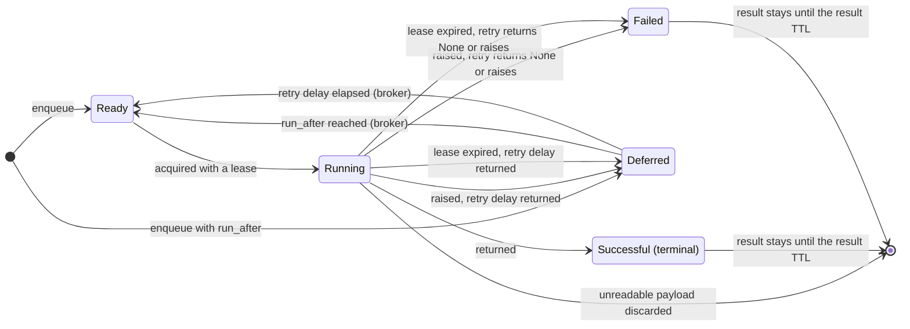
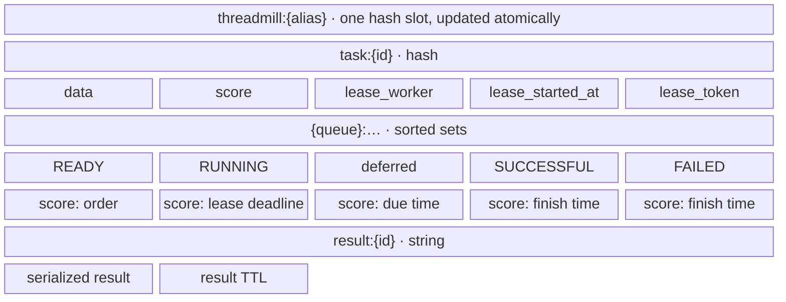
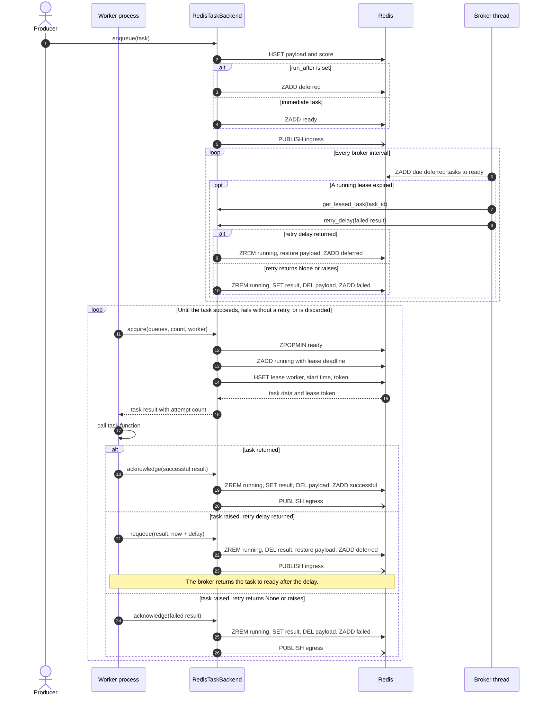

# Contributing

When writing code, you MUST ALWAYS follow the [naming-things](https://github.com/codingjoe/naming-things/blob/main/README.md) guidelines.

<!--
Bots/Agents MUST use:
curl -sSL https://raw.githubusercontent.com/codingjoe/naming-things/refs/heads/main/README.md
-->

## Design Principles

- Durability – We recover from any failures, even poorly written tasks.
- Consistency – We never lose data, even if someone unplugs the power or network.
- Utilization – We keep the CPU saturated with tasks, not with idle time or waiting for locks.

We require a persistent Redis without eviction.

Redis connections explicitly load with `decode_responses=True`, so all values
read from Redis are strings. We do not guard against Redis data altered
mid-flight. We fail loudly instead. These are deliberate design decisions.

## Task lifecycle

A task is in one of five states. `READY` and `DEFERRED` hold pending work.
`RUNNING` holds tasks with a lease. `SUCCESSFUL` and `FAILED` hold results.



`SUCCESSFUL` is the last state for the task. The result stays in Redis for
the result TTL, so `get_result()` can read it. The task never returns to the
queue. The TTL reaper only deletes the stored result.

`FAILED` is the last state for the worker.

A retry never enters `FAILED`. When the task raises an error, the worker calls
the retry callback of the task. If the callback returns a
`datetime.timedelta`, the task moves to `DEFERRED` with that delay. The broker
moves the task to `READY` when the delay is over. The next lease increments
`attempts`, which is `len(worker_ids)`. The callback reads the count with
`TaskContext.attempt`.

`ExponentialBackoff` returns a delay until `max_retries`. If the callback
returns `None` or raises an error, the retry stops. The worker then
acknowledges the task as `FAILED`.

The Ready tab shows `READY` and `DEFERRED` tasks. Results expire after the
result TTL. Later acknowledgements trim the `SUCCESSFUL` and `FAILED` lists.

## Task storage

A pending task has two parts. The work is the function and its arguments. The
queue entry is the task id and a score.

Threadmill stores the work in a task record. Each queue stores only the task id
and a score. The score sets the order in the queue, the lease deadline, or the
due time.



| Part        | Written when                 | Removed when                |
| ----------- | ---------------------------- | --------------------------- |
| Task record | enqueue, lease change, retry | acknowledge, dequeue, purge |
| Queue entry | enqueue, state change        | acknowledge, dequeue, purge |

A state change moves the id. It does not rewrite the work. The lease sits in
the task record, so one field read refuses a worker that lost its lease. The
record keeps the order score. A delayed task returns to its old place in the
queue.

A finished task also has a result record with a lifetime, the result TTL (time
to live). The result lists hold ids.

The two parts must stay in step. If the task record is missing, the queue entry
is stale. The broker drops it and logs a warning. They share a name prefix, so
one server operation changes both.

## Task flow

The worker process leases `READY` tasks, runs them, and acknowledges the
result. The broker thread moves due `DEFERRED` tasks and reaps expired leases.
An expired lease marks the task as `FAILED` with an `AcknowledgementTimeoutError`.
The retry rule then selects requeue or acknowledge.



An acknowledgement removes the `RUNNING` entry only when the lease token
matches. A worker that lost its lease cannot publish a result. The broker then
owns the retry decision for that task.

## Inspector actions

The inspector reads data on its own. It changes data only after an explicit
confirmation. Every action that changes data refreshes the telemetry and the
task list.

Requeue appears only on the Failed tab. It skips the retry callback. Dequeue is
not available on the Running tab, so the inspector never races a live lease.
Purge deletes every segment of a queue. It also deletes the results.

The task list does not refresh automatically. It reloads on a tab switch, a
queue change, F5, and after each action.

## Testing

We have unit tests, integration tests, and benchmarks. Avoid mocking if possible.

To run the tests, use the following command:

```bash
uv run pytest
```

To run only integration tests:

```bash
uv run pytest -m integration
```

To run only integration benchmarks:

```bash
uv run pytest -m "integration and benchmark"
```

Benchmarking snapshots are created automatically.
To compare your feature branch against the main branch,
run the test suite on main, followed by:

```
uv run pytest --benchmark-compare
```

Before your first commit, ensure that the pre-commit hooks are installed by running:

```bash
uvx prek install
```
